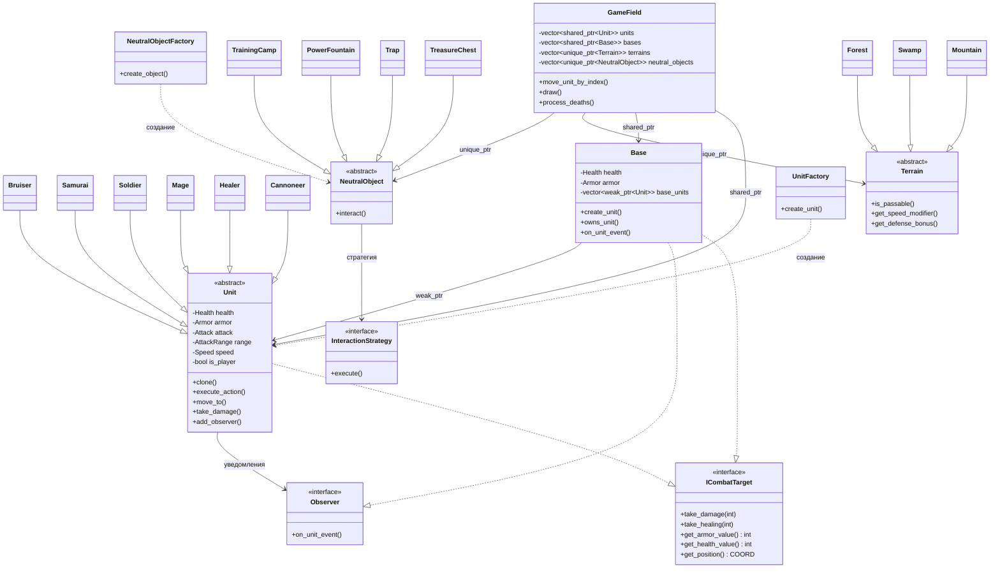

# Тактическая пошаговая игра на C++

## 1. Описание проекта

Проект представляет собой консольную пошаговую тактическую игру, разработанную на языке C++ с использованием объектно-ориентированного программирования.

Игровое поле содержит две команды: игрока и бота. Каждая команда располагает собственной базой и управляет юнитами различных классов. Цель игры — уничтожить базу противника и всех его юнитов.

Игровая логика включает перемещение персонажей, боевые действия, создание новых юнитов, взаимодействие с ландшафтом и нейтральными объектами.

## 2. Основные возможности

### 2.1. Игровое поле

- Игровое поле имеет размер 10 × 10 клеток.
- На поле располагаются две базы, юниты, элементы ландшафта и нейтральные объекты.
- Перемещение осуществляется по клеткам с учётом скорости персонажа и препятствий.
- Другие юниты и базы блокируют перемещение.

### 2.2. Система юнитов

В игре реализовано шесть классов персонажей:

| Класс | Особенности |
|---|---|
| Bruiser | Боец ближнего боя с высокой прочностью |
| Samurai | Боец, способный перемещаться по скалам |
| Soldier | Боец дальнего боя |
| Mage | Персонаж с высокой силой атаки |
| Healer | Восстанавливает здоровье союзников |
| Cannoneer | Персонаж с дальнобойными боевыми характеристиками |

Каждый юнит обладает следующими характеристиками:

- Здоровье (Health).
- Броня (Armor).
- Сила атаки (Attack).
- Дальность действия (AttackRange).
- Скорость перемещения (Speed).

Для унификации боевых взаимодействий используется интерфейс `ICombatTarget`, позволяющий атаковать и лечить различные игровые объекты.

### 2.3. Игровые базы

Каждая команда имеет собственную базу.

База:
- Обладает запасом здоровья и бронёй.
- Создаёт новых юнитов.
- Ограничивает количество одновременно существующих живых юнитов команды тремя персонажами.
- Получает урон от противников.
- Может быть уничтожена.

Уничтожение базы само по себе не завершает игру. Для победы необходимо также уничтожить всех юнитов противника.

### 2.4. Система очков действий

Каждой команде предоставляется три очка действий за ход.

Доступны три вида действий:

1. Создание юнита базой.
2. Перемещение существующего юнита.
3. Выполнение действия юнитом (атака или лечение).

Игрок может использовать любые комбинации действий, в том числе несколько раз подряд выбирать один и тот же тип действия или управлять одним юнитом несколько раз за ход.

Неудачное действие не расходует очко действий.

### 2.5. Ландшафт

В игре реализованы три вида ландшафта:

| Тип | Символ | Особенности |
|---|---|---|
| Mountain | `^` | Проход доступен только самураю |
| Swamp | `~` | На клетку может войти любой юнит, но выйти могут только юниты со скоростью больше 1 |
| Forest | `#` | Предоставляет находящемуся на клетке юниту +10 брони |

### 2.6. Нейтральные объекты

В игре предусмотрены четыре нейтральных объекта:

| Объект | Символ | Эффект |
|---|---|---|
| TreasureChest | `M` | Восстанавливает базе 200 здоровья |
| Trap | `T` | Наносит юниту 150 урона |
| PowerFountain | `F` | Увеличивает силу атаки юнита на 50 |
| TrainingCamp | `C` | Увеличивает дальность действия юнита на 1 |

Взаимодействие с объектами происходит при перемещении юнита на соответствующую клетку. После успешного взаимодействия одноразовый объект становится неактивным.

### 2.7. Искусственный интеллект

Противником игрока выступает бот.

Бот умеет:
- Создавать новых юнитов при наличии свободного места в лимите.
- Перемещать юнитов в сторону противника.
- Обходить препятствия при поиске маршрута.
- Атаковать доступные цели.
- Использовать целителей для восстановления здоровья союзников.

Для поиска маршрута используется алгоритм BFS (поиск в ширину).

## 3. UML-диаграмма классов

Диаграмма отражает основные классы проекта, их наследование и связи между компонентами.

## 4. Использованные паттерны проектирования

В проекте применены следующие паттерны проектирования.

### 4.1. Observer (Наблюдатель)

Паттерн используется для организации взаимодействия между юнитами и их базами.

База подписывается на события принадлежащих ей юнитов и получает уведомления об изменении их состояния.

Реализованы события:
- `Created` — создание юнита.
- `Damaged` — получение урона.
- `Destroyed` — гибель юнита.

Классы:
- `Observer` — интерфейс наблюдателя.
- `Unit` — объект, отправляющий уведомления.
- `Base` — наблюдатель.

Для хранения наблюдателей применяются слабые указатели `std::weak_ptr`, что позволяет избежать циклических зависимостей владения.

### 4.2. Strategy (Стратегия)

Паттерн используется для организации различных вариантов взаимодействия с нейтральными объектами.

Вместо размещения всей логики взаимодействия в одном классе используются отдельные стратегии.

Основные компоненты:
- `InteractionStrategy` — интерфейс стратегии.
- Конкретные стратегии — реализации отдельных эффектов.
- `NeutralObject` — объект, использующий выбранную стратегию.

Благодаря этому можно добавлять новые варианты взаимодействия, не переписывая общую логику нейтральных объектов.

### 4.3. Factory (Фабрика)

Паттерн используется для централизованного создания игровых объектов.

В проекте реализованы две фабрики:

**UnitFactory**

Создаёт юнитов определённых классов в зависимости от переданного типа.

**NeutralObjectFactory**

Создаёт нейтральные объекты определённых типов.

Использование фабрик упрощает создание объектов и уменьшает зависимость игрового кода от конкретных классов.

### 4.4. Интерфейс ICombatTarget

Для унификации боевых взаимодействий используется общий интерфейс `ICombatTarget`.

Его реализуют `Unit` и `Base`.

Благодаря этому боевые классы могут взаимодействовать с различными целями через единый интерфейс, не дублируя логику атаки и лечения.

## 5. Управление памятью

В проекте используются умные указатели стандартной библиотеки C++.

- `std::shared_ptr` применяется для совместного владения юнитами и базами.
- `std::weak_ptr` применяется для хранения ссылок на юнитов внутри базы и наблюдателей.
- `std::unique_ptr` применяется для объектов ландшафта, нейтральных объектов и принадлежащих им стратегий.

Погибшие юниты не удаляются из контейнера игрового поля. Их состояние изменяется, а при отображении они исключаются из списка живых персонажей. Это позволяет сохранять историю игровых объектов и корректно обрабатывать события гибели.

## 6. Результаты проверки игровых сценариев

В ходе проверки работы игры были рассмотрены следующие сценарии.

| № | Сценарий | Ожидаемый результат | Результат |
|---|---|---|---|
| 1 | Запуск игры | Создание поля, баз и стартовых юнитов | Работает |
| 2 | Создание юнита | База создаёт юнита при наличии свободного места | Работает |
| 3 | Превышение лимита юнитов | Создание нового юнита запрещается | Работает |
| 4 | Перемещение юнита | Перемещение с учётом скорости и препятствий | Работает |
| 5 | Перемещение по скале | Проход доступен только самураю | Работает |
| 6 | Перемещение по болоту | Учитывается ограничение выхода с клетки | Работает |
| 7 | Нахождение в лесу | Юнит получает дополнительную броню | Работает |
| 8 | Взаимодействие с сундуком | База восстанавливает 200 здоровья | Работает |
| 9 | Срабатывание ловушки | Юнит получает 150 урона | Работает |
| 10 | Использование фонтана | Увеличивается сила атаки на 50 | Работает |
| 11 | Использование тренировочного лагеря | Увеличивается дальность на 1 | Работает |
| 12 | Атака и лечение | Изменяются характеристики соответствующих целей | Работает |
| 13 | Поведение бота | Создание, перемещение и боевые действия | Работает |
| 14 | Завершение игры | Победа определяется состоянием базы и юнитов | Работает |

По результатам ручной проверки игровой процесс запускается, основные механики взаимодействия с ландшафтом и нейтральными объектами работают.

## 7. Выводы

В результате разработки была создана консольная пошаговая тактическая игра на C++.

В процессе реализации были применены принципы объектно-ориентированного программирования: наследование, инкапсуляция и полиморфизм.

Также были использованы паттерны Observer, Strategy и Factory, позволившие разделить ответственность между игровыми компонентами и упростить расширение проекта.

Использование умных указателей позволило организовать управление памятью и отношения владения между объектами без необходимости ручного освобождения ресурсов.

Реализованы система ходов с тремя очками действий, различные классы юнитов, базы, ландшафт, нейтральные объекты и противник с алгоритмом поиска маршрута.

Поставленные основные задачи проекта выполнены. Архитектура допускает дальнейшее расширение: добавление новых классов персонажей, типов ландшафта, нейтральных объектов и игровых механик.

## 8. Используемые технологии

- Язык программирования: C++.
- Стандарт языка: C++17.
- Среда разработки: Microsoft Visual Studio.
- Стандартная библиотека C++ (STL).
- Умные указатели: `shared_ptr`, `weak_ptr`, `unique_ptr`.
- Алгоритм поиска пути: BFS.
- Диаграммы: Mermaid.
